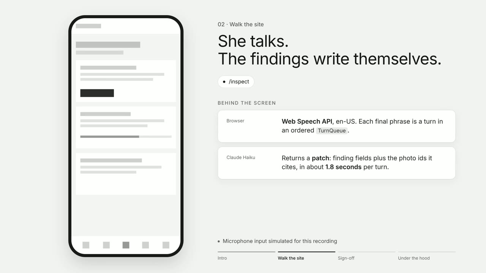
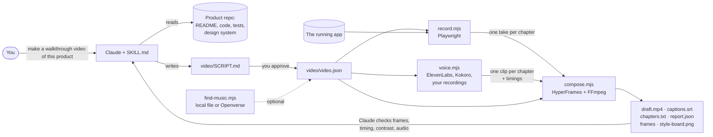

# product-walkthrough-video

<!--
Badges: each one needs the project registered first. Uncomment a badge once it works.
- REUSE: register at https://api.reuse.software/register with the repository URL, then:
  [](https://api.reuse.software/info/github.com/lgarbayo/product-walkthrough-video)
- OpenSSF Scorecard: .github/workflows/security.yml publishes the results; the badge works after its first run on main:
  [](https://scorecard.dev/viewer/?uri=github.com/lgarbayo/product-walkthrough-video)
- OpenSSF Best Practices: sign in at https://www.bestpractices.dev/en/projects/new, add the repository, and paste the badge the site gives you (it carries the project number).
-->
[](https://github.com/lgarbayo/product-walkthrough-video/actions/workflows/check.yml)
[](LICENSE)

A [Claude Code](https://claude.com/claude-code) skill that turns a product (its repository and its running app) into a **2 to 5 minute explainer video**. The video shows the real app working and, next to it, what happens behind each screen, with real numbers taken from the code.

Making a good product walkthrough by hand takes days. You write a script and check every claim against the code. You record each screen, voice it, cut the recordings to the voice, and keep it all consistent with the product's look. This skill does that work with Claude in four steps:

1. Claude reads the product and writes the script.
2. **You approve it.**
3. Three deterministic scripts record the app, make the voice-over and render the video.
4. Claude checks the result against a fixed layout and measurable rules.



*The layout of a chapter, rendered for a fictional product in the neutral reference skin. In a real video the frame holds a recording of your app, and the colours and fonts are your product's.*

The format comes from this reference video: <https://youtu.be/6f3wKt45Vrc>.

## Contents

- [Features](#features)
- [How it works](#how-it-works)
- [Install](#install)
- [Usage](#usage)
- [Configuration](#configuration)
- [Compatibility](#compatibility)
- [Troubleshooting](#troubleshooting)
- [Support](#support)
- [Contributing and project documents](#contributing-and-project-documents)
- [Credits](#credits)
- [License](#license)

## Features

- **Script first, approved by you.** Claude writes `video/SCRIPT.md` from the product's code and README. Every number on screen or in the voice must exist in the code, the tests or a measurement, and the script says where each one comes from. Nothing is recorded and no voice credit is spent until you approve it.
- **A fixed format.** The chapters are an intro, the problem with sourced stats, the architecture diagram built box by box, one chapter per demo beat, under the hood, an optional "how it was built", and a closing. Each demo chapter shows the real app in a phone or browser frame, with "behind the screen" cards that appear on the word the narrator says.
- **The product's own look.** Background, palette, fonts, radius and a drawn motif come from the product's design system. A contrast check (WCAG AA) runs on every render.
- **The real app, recorded.** Playwright records each chapter in a headless browser, one take per chapter, so any chapter can be re-recorded alone. Mock-ups are never used. When something on screen is staged, the chapter says so in an honesty note.
- **A voice-over you choose.** The skill always offers four options and lets you pick:

  | Option | Quality | Cost |
  |---|---|---|
  | **ElevenLabs** (recommended) | the most natural | credits from **your** ElevenLabs account |
  | **Kokoro**, local | good, a little flatter | free, runs on your machine |
  | **Your own voice** | yours | free: record one audio file per chapter |
  | **No voice** | a silent draft with subtitles | free |

  Every option gives one clip per chapter with timings per character, so the cards appear on the word that names them. ElevenLabs returns the timings. For Kokoro and your own recordings, the skill transcribes each clip locally and aligns it to the script. Clips are only regenerated when their text changes, and ElevenLabs has a dry run that prints the characters to be billed.
- **Optional music, measured.** A music bed is ducked under every voice clip, and the mix is checked with a number: under each clip it must measure like the voice alone, within 1 dB. The skill asks you for a file on your machine, or for a kind of music to search on Openverse. It only offers CC0 and CC BY tracks, and keeps their attribution.
- **Measured instead of judged.** Each render writes a report:
  - the loudness and true peak of the voice;
  - the result of the music check;
  - the contrast failures, if any;
  - one frame per scene, and a board that puts each scene next to its layout keyframe.
- **Ready to publish.** Each render also writes the SRT subtitles and the YouTube chapter list.

## How it works



Everything for one video lives in the product's repository, in `video/`. The skill copies its scripts there so the video can be rebuilt without the skill:

```
video/
  SCRIPT.md                       the approved script
  video.json                      what the scripts read: scenes, voice text, recording steps, skin
  record.mjs voice.mjs compose.mjs
  fonts/ cards/ music/            the product's fonts, logo and motif, the music and its credits
  captions.srt chapters.txt       copied from out/ when the video is done
  NOTES.md                        what was made, what is left for a person, how to rebuild
  out/                            renders, recordings and voice clips (ignored by git)
```

The repository itself:

| Path | What it is |
|---|---|
| `SKILL.md` | The procedure Claude follows, step by step |
| `references/format.md` | The fixed format, the skin rules, the voice and the music |
| `references/script.md` | How to write the script |
| `scripts/` | `record.mjs`, `voice.mjs`, `compose.mjs`, `find-music.mjs`, plus `loop-music.mjs` and `analyze-music.mjs` from launch-video-kit |
| `assets/video.example.json` | Every scene kind and field, for a fictional product |
| `assets/style/` | One layout keyframe per scene kind, in neutral greys |

The instructions in `SKILL.md` and `references/` are written in Spanish. Claude follows them whatever language you talk to it in, and the voice-over is in English unless you ask for another language.

## Install

You need:

- **Claude Code** (CLI, desktop or IDE extension);
- **Node.js 22 or newer** (`node -v`);
- **FFmpeg** with `ffprobe` on the `PATH` (`ffmpeg -version`);
- **Playwright** with its Chromium, in the product's project or in any folder you point to with `PLAYWRIGHT_MODULE`. The skill never installs it into your product;
- **HyperFrames**: nothing to install. `compose.mjs` runs a pinned version with `npx`. On the first run it downloads the package and a Chrome build into `~/.cache/hyperframes`; `npx --yes hyperframes@0.8.216 doctor` checks it;
- for the voice, depending on the option you pick:
  - **ElevenLabs**: an API key from your account;
  - **Kokoro**: a Python environment with `kokoro-onnx` and `soundfile` (Claude offers to create it in `~/.cache`, outside your project);
  - **your own voice**: a phone or a microphone.

  Kokoro and your own voice also use `hyperframes transcribe` (Whisper, local) for the timings. The first time it runs, it downloads its model.

Clone the repository into your skills folder:

```sh
git clone https://github.com/lgarbayo/product-walkthrough-video ~/.claude/skills/product-walkthrough-video
```

Start a new Claude Code session. The skill appears in the skill list as `product-walkthrough-video`. To update it later, run `git -C ~/.claude/skills/product-walkthrough-video pull`.

## Usage

### Ask Claude

Open Claude Code in your product's repository and ask for the video in your own words:

```
Make a product walkthrough video of this app for YouTube, three minutes at most.
The live demo is https://example.com.
```

```
I need a video that explains how our API and dashboard work, for investors.
Record it against the local build with the demo data. No music.
```

```
/product-walkthrough-video   (the same, invoked by name)
```

Claude will:

1. read the product and ask only what it cannot work out: the demo URL, the length, the audience, and whether you want music;
2. write `video/SCRIPT.md` and **stop for your approval**;
3. check the tools, record the app, make the voice (dry run first), add the music if you chose it, and render;
4. review every frame, the timing and the audio, fix what is wrong, and report what is left for you.

### Run the scripts yourself

Every step can be re-run by hand from the product's root, for example after changing one chapter:

```sh
# re-record only the jury chapter
PLAYWRIGHT_MODULE=/path/to/folder/with/playwright node video/record.mjs video/video.json --shots jury

# regenerate one voice clip after editing its text (dry run first)
node video/voice.mjs video/video.json --only jury --dry-run
node video/voice.mjs video/video.json --only jury

# a silent draft, no credits spent
node video/voice.mjs video/video.json --estimate

# the free local voice instead, for one pass
HYPERFRAMES_PYTHON=~/.cache/product-walkthrough-video/kokoro/bin/python node video/voice.mjs video/video.json --provider kokoro

# your own voice: the first run writes video/vo-takes/READ.md; record one file per chapter there, then run it again
node video/voice.mjs video/video.json --provider recorded

# render, or preview a few scenes in seconds
node video/compose.mjs video/video.json --style-dir ~/.claude/skills/product-walkthrough-video/assets/style
node video/compose.mjs video/video.json --only intro,arch
```

### Music

```sh
# audio files already on this machine
node ~/.claude/skills/product-walkthrough-video/scripts/find-music.mjs local

# search Creative Commons music (one to three English words work best)
node ~/.claude/skills/product-walkthrough-video/scripts/find-music.mjs search "ambient piano" --min 150

# download the one you picked; its attribution goes to video/music/CREDITS.md
node ~/.claude/skills/product-walkthrough-video/scripts/find-music.mjs get <id> --out video/music
```

Then add `"music": { "src": "music/<file>" }` to `video.json`. If the track is shorter than the video, `scripts/loop-music.mjs` lengthens it without an audible seam.

## Configuration

`video.json` holds everything about one video. `assets/video.example.json` shows every field. The main ones are:

| Field | What it sets |
|---|---|
| `maxSeconds`, `marginSeconds` | The length limit (default 180 s) and how far under it to aim |
| `baseUrl`, `device`, `viewports` | Where the app runs, and the phone or browser frame |
| `setup`, scene `steps` | What the recorder does: requests, `goto`, `click`, `type`, `scroll`, `waitFor`, `mark`... |
| `theme` | The skin: colours, fonts, radius, background, motif |
| `voice` | `provider` (`elevenlabs`, `kokoro`, `recorded`, `none`), the ElevenLabs voice and settings, `kokoroVoice`, `takes` (the folder of your recordings), `language`, and the lead-in and pause per chapter |
| `music` | Optional bed: `src`, `bedLufs` (default -22), `duckDb` (default 9), fades |
| scene `voice`, `cue` | The narration of each scene, and the words on which each card appears |

Environment variables:

| Variable | Used by | Purpose |
|---|---|---|
| `ELEVENLABS_API_KEY` | `voice.mjs` | Your ElevenLabs key. Read from the environment only, never written anywhere |
| `ELEVENLABS_VOICE_ID`, `ELEVENLABS_MODEL_ID` | `voice.mjs` | Override the voice (default "George") or the model (default `eleven_multilingual_v2`) |
| `ELEVENLABS_API_BASE` | `voice.mjs` | Another API host, if you use a proxy |
| `HYPERFRAMES_PYTHON` | `voice.mjs` | The Python with `kokoro-onnx` and `soundfile`, for the Kokoro voice |
| `PLAYWRIGHT_MODULE` | `record.mjs` | A folder whose `node_modules` has `playwright`, when the product has none |
| `CHROMIUM_PATH` | `record.mjs` | Another Chromium or Chrome binary |
| `VIDEO_BASE_URL` | `record.mjs` | Overrides `baseUrl` (so does `--base-url`) |
| `HYPERFRAMES_VERSION`, `HYPERFRAMES_CLI` | `compose.mjs` | Another HyperFrames version, or a local CLI |
| `VIDEO_STYLE_DIR` | `compose.mjs` | The layout keyframes (so does `--style-dir`) |

## Compatibility

| Environment | Status |
|---|---|
| Linux (x86-64), Node 22, FFmpeg 9, Playwright 1.56, HyperFrames 0.8.216 | Used to build and test the skill |
| macOS | Expected to work (all tools support it), not tested yet |
| Windows | Untested. Use WSL |
| Apps recorded | Any web app reachable from the machine: a deployed URL or a local build |

## Troubleshooting

| Problem | What to do |
|---|---|
| `Playwright not found` | Install it outside your product (`npm i --prefix /tmp/pw playwright`) and run with `PLAYWRIGHT_MODULE=/tmp/pw`. Use a Playwright version whose Chromium is already in `~/.cache/ms-playwright`, or run `npx playwright install chromium` |
| A chapter shows the previous chapter's screen | Each chapter must be its own take (the default). If `video.json` has `"takePerScene": false`, remove it |
| `compose.mjs` exits with 2 | The video is over `maxSeconds`. Shorten the voice text first, then drop whole chapters. Do not shrink the type or speed up the pace |
| `compose.mjs` exits with 1 | A degraded render: no voice, stills or placeholders. `report.json` says which scenes |
| A recording holds its last frame for seconds | The take is shorter than its voice. Add `wait` or `after` to that chapter's steps |
| A card appears at the wrong moment | Its `cue` is not a phrase of that scene's voice text (`compose.mjs` warns). Copy the exact words |
| `music.check` fails | The music is too loud under the voice. Raise `duckDb` or lower `bedLufs` |
| `find-music.mjs` reports HTTP 401 or 429 | Openverse allows 20 anonymous requests a minute and 200 a day, with at most 20 results a page. Wait a minute |
| The voice estimate is longer than the script's word count suggests | Expected: estimates add rests at punctuation (about 8 %). Real ElevenLabs clips are usually shorter |
| `voice.mjs` exits with 4 | The chosen voice is not ready: no `ELEVENLABS_API_KEY` or no matching voice, no Python for Kokoro, or recordings missing. It wrote estimates for the missing clips |
| `Kokoro needs a Python with kokoro-onnx and soundfile` | Create one outside your project: `uv venv ~/.cache/product-walkthrough-video/kokoro && uv pip install --python ~/.cache/product-walkthrough-video/kokoro/bin/python kokoro-onnx soundfile`, then run with `HYPERFRAMES_PYTHON` pointing at that Python |
| `only N of M words matched the transcript` | The clip does not read that chapter's text, or `voice.language` is wrong. With your own recordings, check the file name matches the chapter id |

## Support

- **Bugs and ideas:** open an [issue](https://github.com/lgarbayo/product-walkthrough-video/issues) with the templates provided.
- **Questions:** use the "Question" issue template.
- **Security problems:** never in a public issue. See [SECURITY.md](SECURITY.md).

Expect an answer within 48 to 72 hours: this is a free-time project with one maintainer.

## Contributing and project documents

- [CONTRIBUTING.md](CONTRIBUTING.md): how to set up, test and propose changes.
- [SECURITY.md](SECURITY.md): how to report a vulnerability.
- [CHANGELOG.md](CHANGELOG.md): what changed and why.
- [docs/ARCHITECTURE_DECISIONS.md](docs/ARCHITECTURE_DECISIONS.md): the design decisions, with their context and consequences.
- [docs/COMPONENTS_LICENSE.md](docs/COMPONENTS_LICENSE.md): the licences of the project, its components, and the media it uses.

## Credits

- `scripts/loop-music.mjs` and `scripts/analyze-music.mjs` come unchanged from [launch-video-kit](https://github.com/borjaperfra/launch-video-kit) by Borja Pérez Francés (MIT). Its README also shaped how this skill handles the voice and the music mix. The details are in [CREDITS.md](CREDITS.md).
- The videos are rendered with [HyperFrames](https://www.npmjs.com/package/hyperframes), recorded with [Playwright](https://playwright.dev) and voiced with [ElevenLabs](https://elevenlabs.io) or [Kokoro](https://huggingface.co/hexgrad/Kokoro-82M) (through HyperFrames). The music search uses the [Openverse](https://openverse.org) API.

## License

[MIT](LICENSE) © 2026 Luis Garbayo Fernández. The software is provided "as is", **without warranty of any kind**. The files from launch-video-kit keep their own MIT notice; see [docs/COMPONENTS_LICENSE.md](docs/COMPONENTS_LICENSE.md).
